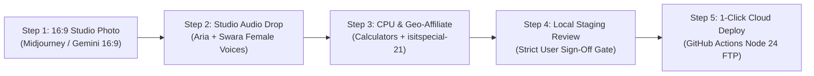

# 📘 The Editorial & Publishing Playbook — isitspecial.com

> **The Definitive Standard Operating Procedure for Article Production, Monthly Scheduling, Usability/UX, SEO, GEO, and Bilingual Publishing.**  
> *Primary Language:* English (`/blog/[slug]`) | *Localized Edition:* Hindi (`/hi/blog/[slug]`)  
> *Amazon Associate Tag:* `isitspecial-21` | *Default Image Standard:* `16:9` WebP @ 70% quality (< 100 KB)

---

## 📑 Table of Contents
1. [The 10-Article Monthly Scheduling Engine](#1-the-10-article-monthly-scheduling-engine)
2. [Editorial Pillars & The Special Index™ Framework](#2-editorial-pillars--the-special-index-framework)
   - [2.1 The Post-20 "Versus" Directive](#21-the-post-20-versus-head-to-head-comparison-directive)
   - [2.2 The Signature Feature Duo: Audio Verdict & CPU Calculator](#22-the-signature-feature-duo-audio-verdict--cost-per-use-calculator)
3. [End-to-End Article Production Flow](#3-end-to-end-article-production-flow)
4. [Bilingual Publishing Guidelines (English & Native Hindi)](#4-bilingual-publishing-guidelines-english--native-hindi)
5. [Visual Asset Generation & Image Prompt Engineering](#5-visual-asset-generation--image-prompt-engineering)
6. [Affiliate, Retailer & Legal Compliance](#6-affiliate-retailer--legal-compliance)
7. [UX & Usability Standards (Typography, Dividers & Brand System)](#7-ux--usability-standards)
8. [Technical SEO & Structured Data Requirements](#8-technical-seo--structured-data-requirements)
9. [GEO (Generative Engine Optimization) & AI Citability](#9-geo-generative-engine-optimization--ai-citability)
10. [Pre-Flight Build & Verification Checklist](#10-pre-flight-build--verification-checklist)
11. [Multi-Scene Video Production Engine (12-Scene Modular Video Standard)](#11-multi-scene-video-production-engine-12-scene-modular-video-standard)
12. [YouTube Channel Setup & Video Publishing Engine](#12-youtube-channel-setup--video-publishing-engine)
    - [12.1 One-Time Channel Setup (Targeting Traffic to isitspecial.com)](#121-one-time-channel-setup-targeting-traffic-to-isitspecialcom)
    - [12.2 Repeat Video Publishing Protocol (Per Video Release)](#122-repeat-video-publishing-protocol-per-video-release)
    - [12.3 Post-Publish On-Site Video Embedding & VideoObject SEO Schema](#123-post-publish-on-site-video-embedding--videoobject-seo-schema)
    - [12.4 Additional Growth & Traffic Multipliers](#124-additional-growth--traffic-multipliers)

---

## 1. The Universal 10-Article Monthly Scheduling Engine

To guarantee consistent indexing by search engines, uninterrupted predictability, and regular crawl cycles by AI search crawlers (Perplexity, GPTBot, ClaudeBot, Google-Extended), `isitspecial.com` runs on an exact mathematical publishing cadence of **exactly 10 articles per month**, scheduled every **3 days** from the 1st through the 28th.

### 📅 The Universal 10-Date Release Series (All Months)
Every single month—whether it has 28, 29, 30, or 31 days—uses the exact same 10 publication dates:

$$\mathbf{1, 4, 7, 10, 13, 16, 19, 22, 25, 28}$$

* **Slot 1:** 1st of the month
* **Slot 2:** 4th of the month
* **Slot 3:** 7th of the month
* **Slot 4:** 10th of the month
* **Slot 5:** 13th of the month
* **Slot 6:** 16th of the month
* **Slot 7:** 19th of the month
* **Slot 8:** 22nd of the month
* **Slot 9:** 25th of the month
* **Slot 10:** 28th of the month

### 💡 Why We Cap at the 28th (The Month-Turnover Reset):
* **Zero Date Clashing:** By concluding every month on the 28th, we prevent back-to-back releases (e.g. publishing on the 31st and then immediately publishing on the 1st of the following month).
* **Universal Consistency:** There are no month-end edge cases or awkward calendar rules. February, April, and December follow the exact identical release rhythm.
* **Natural Buffer:** The 3-to-4 day window between the 28th and the 1st of the next month allows for buffer review, analytics audits, and staging the upcoming month's asset queue.

### 🗓️ Annual Master Publishing Cadence Matrix

| Month | Days in Month | Universal Scheduled Publication Dates | Monthly Total |
| :--- | :---: | :--- | :---: |
| **January** | 31 | `1, 4, 7, 10, 13, 16, 19, 22, 25, 28` | **10** |
| **February** | 28 / 29 | `1, 4, 7, 10, 13, 16, 19, 22, 25, 28` | **10** |
| **March** | 31 | `1, 4, 7, 10, 13, 16, 19, 22, 25, 28` | **10** |
| **April** | 30 | `1, 4, 7, 10, 13, 16, 19, 22, 25, 28` | **10** |
| **May** | 31 | `1, 4, 7, 10, 13, 16, 19, 22, 25, 28` | **10** |
| **June** | 30 | `1, 4, 7, 10, 13, 16, 19, 22, 25, 28` | **10** |
| **July** | 31 | `1, 4, 7, 10, 13, 16, 19, 22, 25, 28` | **10** |
| **August** | 31 | `1, 4, 7, 10, 13, 16, 19, 22, 25, 28` | **10** |
| **September** | 30 | `1, 4, 7, 10, 13, 16, 19, 22, 25, 28` | **10** |
| **October** | 31 | `1, 4, 7, 10, 13, 16, 19, 22, 25, 28` | **10** |
| **November** | 30 | `1, 4, 7, 10, 13, 16, 19, 22, 25, 28` | **10** |
| **December** | 31 | `1, 4, 7, 10, 13, 16, 19, 22, 25, 28` | **10** |
| **Full Year** | — | **Exactly 120 Articles / Year (Bilingual = 240 Pages)** | **120** |

---

## 2. Editorial Pillars & The Special Index™ Framework

Every product reviewed on `isitspecial.com` must fall under one of our three core editorial pillars:

1. **Hype vs. Reality:** De-influencing viral social media phenomena and status flexes (e.g., Stanley Quencher, Dyson Supersonic, luxury smartwatches).
2. **Everyday Curiosities / Marvels:** Revealing the brilliant physics, tolerances, and design secrets in mass-market objects that cost almost nothing (e.g., Casio F-91W, Bic Cristal Pen).
3. **Craft & Design:** Celebrating heirloom craftsmanship, repairability, and materials that outlive the owner (e.g., Lodge Cast Iron, Japanese Selvedge Denim).

### 🏆 The Special Index™ Scoring Scale (1.0 to 10.0)
Our scoring is uncompromising and non-negotiable:

| Score Range | Verdict Tag (EN) | Verdict Tag (HI) | Meaning & Standard |
| :---: | :--- | :--- | :--- |
| **9.5 – 10.0** | **Modern Masterpiece** | **आधुनिक मास्टरपीस** | Unrivaled efficiency, democratic accessibility, permanent design museum caliber. Accidental perfection. |
| **8.5 – 9.4** | **True Gem** | **सच्चा नगीना** | Outperforms rivals costing 10x as much; virtually indestructible heirloom with authentic repairability. |
| **6.0 – 8.4** | **Solid Standard** | **सॉलिड स्टैंडर्ड** | Competent product with real ergonomic utility, but held back by noticeable design compromises or minor overpricing. |
| **< 6.0** | **Overhyped** | **ओवरहाइप्ड (सिर्फ दिखावा)** | Premium pricing driven primarily by celebrity influencer marketing, planned obsolescence, or zero repairability. |

---

## 2.1 The Post-20 "Versus" (Head-to-Head Comparison) Directive

Once the publication reaches its initial benchmark of **20 standalone flagship investigations**, the editorial schedule permanently integrates **Head-to-Head "Versus" Showdowns** into the publishing mix (e.g. 1 out of every 3 articles).

### 🥊 The Architecture of a "Versus" Teardown:
* **High-Intent Search Targeting:** Queries like *"Le Creuset vs. Lodge"* or *"AeroPress vs. Moka Pot"* capture readers at the final moment of purchase intent.
* **Direct Empirical Comparison Matrix:** Side-by-side materials table (Weight, Heat Retention, Failure Modes, Repairability, Cost-per-Year).
* **The Nuanced Verdict:** Avoid lazy "it depends" answers; declare an unambiguous winner for specific consumer profiles (e.g., *"If you braise acidic wine stews twice a week, buy Le Creuset; for everything else, the $25 Lodge wins"*).

---

## 2.2 The Signature Feature Duo: Audio Verdict & Cost-Per-Use Calculator

Every single teardown on `isitspecial.com` must feature our two proprietary reader-utility engines:

### 🎙️ 1. The 45-Second Neural Voice Verdict (`<AudioVerdictPlayer />`)
Positioned prominently immediately below the opening hook/paradox question and directly above Section 1. It provides busy readers with an authentic, broadcast-grade audio briefing of the teardown.

* **Mandatory Component:**
  ```astro
  <AudioVerdictPlayer 
    audioSrc="/audio/[slug]-verdict-en.mp3" 
    duration="0:45" 
    lang="en" 
  />
  ```
* **Voice Models (Natural Studio Quality):**
  * **English:** `en-US-AriaNeural` tuned to `-2%` tempo (`rate="-2%"`). Warm, articulate, deep-toned, documentary-style delivery with zero robotic sibilance or metallic crackle.
  * **Hindi:** `hi-IN-SwaraNeural`. Microsoft's premier natural female voice for Hindi, spoken in a clear, engaging, conversational cadence.
* **Audio Script Guidelines:**
  * **Duration:** 35 to 45 seconds (~70 to 90 words).
  * **Spoken-Word Quality Rule:** Absolutely NO raw markdown (`#`, `**`, `[]`), NO hyphens or slashes, and NO unexpanded numbers or abbreviations. Write out words in full (e.g. *"four hundred and twenty dollars"*, *"ten out of ten"*, *"sixty seconds"*).
  * **Structure:** State the consumer dilemma, reveal the core metallurgical or physics finding, and declare the score and verdict.
  * **Generation Pipeline:** Managed via `scripts/generate-all-audio.py` using `edge-tts`. Files are saved to `public/audio/[slug]-verdict-en.mp3` and `public/audio/[slug]-verdict-hi.mp3`.

---

### 🧮 2. The True Cost-Per-Use (CPU) & Longevity Calculator (`<CostPerUseCalculator />`)
Positioned directly above the final Verdict / Special Index section. It replaces marketing intuition with cold, empirical arithmetic, proving whether an heirloom upfront investment actually saves money over disposable alternatives.

* **Mandatory Component (English Example):**
  ```astro
  <CostPerUseCalculator 
    productName="Le Creuset 5.5-Qt Dutch Oven"
    productPrice={420}
    heirloomLifespanYears={30}
    competitorName="Budget $70 Enameled Pot"
    competitorPrice={70}
    competitorLifespanYears={3}
    unitLabel="meal"
    unitLabelPlural="meals"
    defaultFrequencyPerWeek={3}
    defaultYears={20}
    currencySymbol="$"
    lang="en"
  />
  ```
* **Mandatory Component (Hindi Localized Example):**
  ```astro
  <CostPerUseCalculator 
    productName="Le Creuset 5.5-Qt डच ओवन"
    productPrice={35000}
    heirloomLifespanYears={30}
    competitorName="सस्ता ₹5,000 एनामेल्ड बर्तन"
    competitorPrice={5000}
    competitorLifespanYears={3}
    unitLabel="भोजन"
    unitLabelPlural="भोजन"
    defaultFrequencyPerWeek={3}
    defaultYears={20}
    currencySymbol="₹"
    lang="hi"
  />
  ```
* **Section Heading Rules:**
  * **English:** `## The True Cost-Per-Use (CPU) Equation`
  * **Hindi:** `## लागत-प्रति-उपयोग (CPU) का वास्तविक गणित`

---

## 3. End-to-End Article Production Flow (The 5-Step Standard)

Every article strictly follows this 5-step production and publishing protocol:



### 🛑 Non-Negotiable Gate: No Publishing Without User Sign-Off
**Zero unapproved deployments.** No article may be committed or pushed to production until the user has personally reviewed the hero image, tested the audio verdict clips locally, verified the CPU calculator, and provided an explicit **"Approved to Publish"** confirmation.

### The 5 Production Steps in Detail:

1. **Step 1: Visual Asset Generation (AI Studio Prompt / 16:9 Hero Render)**
   - Draft a photorealistic, commercial studio prompt matching the product's authentic materials.
   - Strictly `16:9` aspect ratio (minimum `1920 × 1080 px` or `1280 × 720 px`).
   - Converted and saved locally to `public/images/[slug].webp` (WebP @ 70% quality, `< 100 KB`, yielding ~90% file size reduction with zero perceptible quality loss).
   - Prompt structure: `[Shot Type] + [Product Model, Color, Materials] + [Tactile Studio Surface] + [Natural Rim Lighting] + [16:9 banner aspect ratio]`.

2. **Step 2: Studio Voice Verdict Generation (Edge-TTS)**
   - Author conversational 45-second scripts in English and Hindi.
   - Run `python scripts/generate-all-audio.py` to compile neural MP3 files with `en-US-AriaNeural` (English) and `hi-IN-SwaraNeural` (Hindi).
   - Saved to `public/audio/[slug]-verdict-en.mp3` and `public/audio/[slug]-verdict-hi.mp3`.

3. **Step 3: Cost-Per-Use & Dynamic Geo-Affiliate Configuration**
   - Calculate realistic heirloom vs. disposable pricing and lifespans.
   - Configure `<CostPerUseCalculator />` with `$` for EN and `₹` for HI.
   - Configure `<SpecialIndexCard />` passing `productKeyword` and tag `isitspecial-21`.

4. **Step 4: Local Staging Preview & Sign-Off**
   - Test locally on `http://localhost:4321/blog/[slug]` and `http://localhost:4321/hi/blog/[slug]`.
   - Verify layout, test audio playback, check slider responsiveness, and verify single horizontal divider lines.
   - Present the preview to the user in a review artifact for explicit approval.

5. **Step 5: 1-Click Cloud Deployment via GitHub Actions**
   - Once approved, git commit and push to `origin main`.
   - GitHub Actions (`.github/workflows/deploy.yml` on Node 24) automatically runs static generation (`npm run build`).
   - Sitemaps (`/sitemap-index.xml`) and RSS feeds (`/rss.xml`) update automatically in real-time.

---

### Mandatory In-Article Sections
Every article must follow this narrative arc:
1. **The Hook & Paradox (Paragraphs 1–3):** Contrast luxury claims or viral hysteria against historical reality.
2. **Feature #1: The 45-Second Voice Briefing:** `<AudioVerdictPlayer audioSrc="..." duration="0:45" lang="..." />` right before Section 1.
3. **Section 1: The Physics / Metallurgy / Micro-Engineering:** Provide granular, non-obvious engineering facts (e.g., vitreous glass fusion, 0.1-micron tungsten balls, thermal mass retention).
4. **Section 2: The Unvarnished Flaws:** The friction and flaws influencers never show (leaks, repairability bans, power brick weight).
5. **Section 3: The Superior Alternative ("The De-influencer"):** Direct recommendation of a more practical, cheaper, or more durable alternative.
6. **Feature #2: The True Cost-Per-Use (CPU) Equation:** `<CostPerUseCalculator ... />` proving long-term mathematical economics.
7. **The Final Verdict:** [`SpecialIndexCard`](file:///d:/_Anti-Gravity/_isitspecial/src/components/SpecialIndexCard.astro) containing the score, summary, pros, cons, target personas, and store callout.

---

## 4. Bilingual Publishing Guidelines (English & Native Hindi)

Every piece of content is published simultaneously in **English** and **Hindi** to serve both global audiences and the massive Indian consumer market.

### 🚫 Strict Anti-Machine-Translation Standard
* **Do NOT use literal Google Translate prose:** Hindi articles must read as if authored by a senior Hindi investigative journalist.
* **Idiomatic Conversational Tone:** Use authentic terminology (e.g., "रेज़गारी के दाम", "सच्चा नगीना", "अमर शिल्प कौशल", "मास्टरपीस").
* **Currency Localization:** Always specify prices in Indian Rupees (₹) alongside global USD references (e.g., *"₹3,999 (लगभग $45)"*).
* **Parity Guarantee:** Both language editions share the exact same hero image, score, pros/cons count, and layout structure.

### Frontmatter Architecture

#### English File (`src/content/blog/[slug].mdx`):
```yaml
---
title: "Why the 30-Cent Bic Cristal Pen is an Unmatched Miracle of Engineering"
description: "How a disposable French plastic tube from 1950 writes for 2 full miles..."
pubDate: 2026-10-24
category: "Everyday Curiosities"
heroImage: "/images/bic-pen.webp"
author: "Is It Special Editorial Desk"
authorRole: "Materials & Design Research"
specialScore: 9.8
specialVerdict: "Modern Masterpiece"
readingTime: "5 min read"
featured: false
lang: "en"
---
```

#### Hindi File (`src/content/blog/hi/[slug].mdx`):
```yaml
---
title: "मात्र ₹25 का Bic Cristal पेन असल में इंजीनियरिंग का बेजोड़ चमत्कार क्यों है?"
description: "1950 का एक साधारण फ्रेंच प्लास्टिक पेन जो बिना रुके 3 किलोमीटर लिखता है..."
pubDate: 2026-10-24
category: "रोज़मर्रा के अजूबे"
heroImage: "/images/bic-pen.webp"
author: "Is It Special संपादकीय डेस्क"
authorRole: "सामग्री एवं डिज़ाइन अनुसंधान"
specialScore: 9.8
specialVerdict: "आधुनिक मास्टरपीस"
readingTime: "5 मिनट पढ़ें"
featured: false
lang: "hi"
translationSlug: "bic-cristal-ballpoint-pen"
---
```

> **Bidirectional Routing:** Setting `translationSlug: "[slug]"` in the Hindi file automatically activates the navbar language switcher button on both the English and Hindi pages.

---

## 5. Visual Asset Generation & Image Prompt Engineering

All hero banners must be custom AI-generated studio product photographs adhering to strict commercial lighting rules and encoded in modern WebP format.

### 📐 Image Specifications
* **Aspect Ratio:** Strictly `16:9` widescreen banner.
* **Resolution:** Minimum `1920 × 1080 px` (or `1280 × 720 px` high-DPI).
* **Format:** **WebP at 70% quality** (`.webp`).
* **Target File Size:** `< 100 KB` (typically 25 KB – 45 KB, achieving 85–90% byte reduction vs. legacy JPEG without perceptible loss).
* **Storage Location:** `public/images/[slug].webp`.
* **Social Scraper Exception:** `public/og-image.jpg` is preserved exclusively in JPEG format for external social scrapers (WhatsApp, Facebook, iMessage) that lack full WebP preview support.

### 🛠️ Mandatory Python WebP Compression Command
When generating or acquiring high-resolution source product images (PNG/JPG), immediately convert to production `.webp` via Python Pillow:

```python
from PIL import Image

# Open source image and ensure RGB mode
img = Image.open("source-image.png").convert("RGB")

# Save as WebP at 70% quality with maximum compression effort (method=6)
img.save("public/images/[slug].webp", format="WEBP", quality=70, method=6)
```

### 🎨 Master Prompt Anatomy for ChatGPT / Midjourney
Always format prompts with these 5 core elements:
```text
[Shot Type & Style] + [Exact Product Model, Color, Materials] + [Tactile Studio Pedestal/Surface] + [Atmospheric Rim & Diffused Lighting] + [Aspect Ratio: 16:9 banner]
```

#### Exemplar Prompts from Queue:
* **Stanley Tumbler:**
  `A wide-angle, hyper-realistic commercial studio photograph of a 40 oz pastel cream Stanley Adventure Quencher tumbler with handle and straw, standing on a minimalist concrete and oak desk next to an open notebook and laptop, warm diffused morning sunlight, crisp product photography, 16:9 banner aspect ratio.`
* **Dyson Supersonic:**
  `A striking, hyper-realistic minimalist studio product photograph of a metallic fuchsia and nickel Dyson Supersonic hair dryer resting on a smooth grey volcanic stone pedestal, soft atmospheric rim lighting highlighting the iconic hollow cylindrical aperture and magnetic nozzle, clean luxury editorial aesthetic, 16:9 banner aspect ratio.`
* **Selvedge Denim:**
  `An authentic, high-definition close-up macro photograph of raw, stiff Japanese selvedge denim, showing the neat red-and-white ticker selvedge edge turned up on the cuff over a rustic aged wooden worktable, visible slubby weave texture and rich deep indigo rope-dyed yarn, natural warm workshop window lighting, 16:9 banner aspect ratio.`

---

## 6. Affiliate, Retailer & Legal Compliance

Monetization is secondary to editorial integrity. Every link must comply with FTC, Amazon Associates, and search engine link quality guidelines.

### 🛒 Multi-Store [`SpecialIndexCard`](file:///d:/_Anti-Gravity/_isitspecial/src/components/SpecialIndexCard.astro) Architecture

Our official Amazon affiliate card is built as a balanced 3-row stacked container:
* **Row 1:** Official brand pill (`[a amazon]`) + single-line headline `Check Real-Time Pricing & Stock`.
* **Row 2:** Side-by-side action buttons:
  * `[ 📋 Copy Verdict ]`: 1-click clipboard copy of the article verdict and score for easy sharing.
  * `[ 🛒 Check Price on Amazon → ]`: Clean international label without `.in` or `.co.uk` domain noise, while smart client geo-routing dynamically resolves the reader's locale and applies tag `isitspecial-21`.
* **Row 3:** Full-width bottom transparency disclaimer spanning the card footer.

```astro
<SpecialIndexCard 
  score={9.2}
  verdict="True Gem"
  summary="..."
  pros={[...]}
  cons={[...]}
  whoShouldBuy="..."
  whoShouldSkip="..."
  affiliateUrl="https://link.amazon/..." 
  productKeyword="Lodge 10.25 Inch Cast Iron Skillet"
  affiliateLabel="Check Price on Amazon →"
  affiliateStore="Amazon"
  isAffiliate={true}
  lang="en"
/>
```

#### Supported Scenarios:
1. **Amazon US & India:**
   * Provide `productKeyword` for automatic smart fallback targeting (`amazon.com` for EN, `amazon.in` for HI with tag `isitspecial-21`).
   * When a direct shortlink is provided (e.g., `https://link.amazon/...`), pass `affiliateUrl`.
2. **Third-Party Retailers (e.g. Myntra, Tata Cliq, Brand Direct):**
   * Set `affiliateStore="Myntra"` (card displays custom shopping bag pill instead of Amazon logo).
   * If non-monetized convenience link, set `isAffiliate={false}` (card automatically informs readers: *"Direct non-affiliate retailer link provided purely for reader convenience"*).

### ⚖️ Legal Disclosures (Never Remove)
* **FTC & Amazon Operating Agreement:** Mandatory statutory sentence placed in [`src/components/Footer.astro`](file:///d:/_Anti-Gravity/_isitspecial/src/components/Footer.astro) and [`src/pages/terms.astro`](file:///d:/_Anti-Gravity/_isitspecial/src/pages/terms.astro):
  > *"As an Amazon Associate, isitspecial.com earns from qualifying purchases."*
* **Link Attributes:** Every outgoing affiliate/retailer anchor tag must contain:
  `rel="nofollow sponsored noopener"`

---

## 7. UX, Usability & Brand System Standards

`isitspecial.com` is designed for ruthless reading speed, aesthetic elegance, and zero visual clutter.

### ✒️ Typography & Divider Rules
* **Headings:** Serif editorial font (*Bitter* / *Noto Serif Devanagari*).
* **Body:** Crisp, high-legibility geometric sans-serif (*Inter* / *Noto Sans Devanagari*).
* **Monospace / Scores:** Heavy numerical tabular figures.
* **⚠️ Single Horizontal Divider Rule (No Duplicate Lines):**
  * Section dividers must be authored exclusively with markdown `---` (`<hr>`).
  * Never apply `border-t` to `<h2>` headings inside typography CSS or templates. This prevents double parallel horizontal lines from appearing above section titles.

### 🟢 Official Brand Identity & Device Assets
* **Official Brand Emblem:** A high-gloss deep emerald circular pin featuring a stylized intertwined "iS" lettermark in white and mint green.
* **Multi-Device Icon Suite:**
  * `favicon.ico`: Multi-resolution ICO (16×16, 32×32, 48×48) for desktop tabs and Windows taskbars.
  * `favicon-32x32.png` & `favicon-16x16.png`: High-DPI browser tab icons.
  * `apple-touch-icon.png` (180×180 px): For iOS and iPadOS home screen bookmarks.
  * `icon-192.png` & `icon-512.png`: For Android home screen and PWA splash screens.
  * `site.webmanifest`: PWA manifest with theme color `#15803d` and background `#f7faf7`.
* **Social Preview Card (Open Graph & Twitter):**
  * Primary fallback image: `public/og-image.jpg` (1200×630 px MozJPEG @ 92% quality, retained specifically for WhatsApp, iMessage, and Facebook scrapers alongside modern WebP assets).
* **Footer Attribution:**
  * Must display: `Website Design by GyanArt` linking to `https://www.gyanart.com` (Hindi edition: `वेबसाइट डिज़ाइन: GyanArt`).

### ♿ Accessibility (WCAG AA/AAA)
* **CTA buttons:** Pure black text (`#09090b`) on rich amber backgrounds (`#fbbf24`), delivering ultra-high contrast (> 12:1 ratio).
* **Scorecard badges:** Dynamically color-coded based on verdict (Rose for overhyped, Emerald for gems, Amber for standards).
* **Zero Cumulative Layout Shift (CLS):**
  * Hero images specify explicit `16:9` aspect ratio containers to prevent page jump during rendering.
* **Instant Static Navigation:**
  * Zero client-side JavaScript hydration bloat; pure HTML/CSS generated via Astro static mode.

---

## 8. Technical SEO & Structured Data Requirements

Every published article must pass automated search validation:

1. **Schema.org Structured Data:**
   * Embedded JSON-LD automatically generated in [`src/layouts/PostLayout.astro`](file:///d:/_Anti-Gravity/_isitspecial/src/layouts/PostLayout.astro):
     * `@type: "Article"` & `@type: "Review"`
     * `itemReviewed`: Product name, category, and review score.
     * `reviewRating`: Value out of 10, bestRating 10, worstRating 1.
     * `publisher`: Verified organization with logo `https://www.isitspecial.com/logo.png`.
2. **Canonical & Alternate Hreflang Tags:**
   * `link rel="canonical"` points to the exact article URL.
   * `link rel="alternate" hreflang="hi"` / `hreflang="en"` links localized editions.
3. **Automated XML Sitemap:**
   * Built on every release at `/sitemap-index.xml` via `@astrojs/sitemap`.

---

## 9. GEO (Generative Engine Optimization) & AI Citability

AI-driven search engines (ChatGPT Search, Perplexity, Google AI Overviews, Claude) require specific structural optimization to ensure our articles are cited as authoritative sources.

### 🤖 High-Citability Content Rules:
* **Data Density:** Include exact metrics in every review (e.g., *"0.1 micron ball tolerance"*, *"5.4 lbs thermal iron mass"*, *"110,000 RPM V9 motor"*). AI engines cite definitive figures over generic adjectives.
* **Clear Answer Format:** The first 100 words directly answer conversational queries (e.g., *"Is the Stanley cup worth it?"* -> *"No, the FlowState lid leaks easily when tilted..."*).
* **`llms.txt` Synchronization:** Every new live article must be appended to [`public/llms.txt`](file:///d:/_Anti-Gravity/_isitspecial/public/llms.txt) with its one-line verdict, score, and URL for direct indexing by AI agents.

---

## 10. Pre-Flight Build & Verification Checklist

Before any batch is committed or pushed to production:

- [ ] **Bilingual Parity:** Both `src/content/blog/[slug].mdx` and `src/content/blog/hi/[slug].mdx` exist and have synchronized `translationSlug`.
- [ ] **Image Health:** Hero photo is placed at `public/images/[slug].webp` in 16:9 ratio, encoded in WebP @ 70% quality (`< 100 KB`), and preloads smoothly without layout shift.
- [ ] **🎙️ Audio Verdicts:** Both `public/audio/[slug]-verdict-en.mp3` (`en-US-AriaNeural`) and `public/audio/[slug]-verdict-hi.mp3` (`hi-IN-SwaraNeural`) are generated, tested, and referenced in `<AudioVerdictPlayer />`.
- [ ] **🧮 CPU Calculator:** `<CostPerUseCalculator />` is embedded with tailored product economics, localized currencies (`$` for EN, `₹` for HI), and realistic lifespans.
- [ ] **🛒 Amazon Box Tested:** Store button functions cleanly with geo-routing and the `isitspecial-21` tag; Copy Verdict button works.
- [ ] **📏 Divider Integrity:** Verify no double horizontal lines appear above section headings.
- [ ] **Local Build:** Run `npm run build` and ensure **zero errors** with all routes generated.
- [ ] **Pipeline Updated:** Update [TASKS.md](file:///d:/_Anti-Gravity/_isitspecial/TASKS.md) status to 🟢 `LIVE`.
- [ ] **AI Directory:** Append entry to [`public/llms.txt`](file:///d:/_Anti-Gravity/_isitspecial/public/llms.txt).
- [ ] **Git Discipline:** Commit with clean milestone message.

---

## 11. Multi-Scene Video Production Engine (12-Scene Modular Video Standard)

To power high-velocity visual discovery on YouTube Shorts, Instagram Reels, and long-form video platforms, every published article on `isitspecial.com` must be structured into an automated **12-scene modular video production package**.

Each scene is designed as a standalone **10-second micro-story** (12 scenes = 120 seconds / 2 minutes total), which can be published as:
1. **12 Individual Vertical Micro-Shorts (9:16)** for rapid audience discovery and high view counts.
2. **A Unified 16:9 Widescreen Video Essay (2 Minutes)** with cinematic motion, on-screen text, voiceover, and SFX.

### 📐 Visual Asset Standards for Video
* **Aspect Ratio:** Strictly `16:9` widescreen banner (`1920 × 1080 px` or `3840 × 2160 px` 4K).
* **Format:** **100% Maximum Quality JPEG** (`.jpg`) with `subsampling=0` (4:4:4 sampling, ~1 MB per image).
  > **Note:** Modern `.webp @ 70%` is reserved exclusively for web browser delivery to achieve sub-second page loads. Video generation models (Google Omni Flash, Veo, Runway, Kling) require uncompressed 100% JPEG starting frames to prevent video compression artifacts.
* **Storage Location:** `public/images/[slug]-scene-[01-12]-[name].jpg`.

### 🎞️ The Standard 12-Scene Narrative Blueprint
Every review must adhere to this exact 12-beat storytelling arc:

| Scene # | Narrative Beat | Core Focus | Visual Style |
| :---: | :--- | :--- | :--- |
| **01** | **The Luxury Paradox** | $15,000+ luxury industry standard vs. affordable utilitarian underdog. | Split-composition commercial studio shot. |
| **02** | **The Inventor & Origin** | Historical engineering origin (Stanford lab, aerospace, patent breakthrough). | Nostalgic workshop blueprints, calipers, prototype. |
| **03** | **Global Verification** | World championship, international cult following, museum collection. | High-energy event stage or gallery spotlight. |
| **04** | **The Physics Flaw of Status Quo** | Why traditional methods fail (channeling, thermal loss, bitter acids). | Microscopic flow visualization, high-speed physics. |
| **05** | **Micro-Engineering Innovation** | Core structural breakthrough (total immersion, tolerances, airtight seal). | Clear chamber bloom, luminous macro fluid dynamics. |
| **06** | **Thermodynamic Chemistry** | Exact temperature & extraction kinetics (e.g. 80°C sub-boiling chemistry). | Analog thermometer gauge, kettle pour, rising steam. |
| **07** | **Pressure & Mechanical Dynamics** | Physics of the hand/lever force (e.g. 0.75 bar air pocket compression). | Slow-motion descending plunger, rich concentrate stream. |
| **08** | **Filtration & Purity Membrane** | Separation of unwanted compounds (diterpenes, fines, zero sludge). | Side-by-side backlit liquid clarity comparison. |
| **09** | **Materials Science & Durability** | Drop-resistance, food-grade polymer/metal, zero electronic parts. | Outdoor rugged backpack, granite summit, indestructible. |
| **10** | **The 3-Second Maintenance Ritual**| Effortless cleanup, squeegee action, dry puck ejection. | High-speed slow-motion pop into compost bin. |
| **11** | **Cost-Per-Use (CPU) Equation** | Mathematical economics vs. disposable pods/competitors over 15 years. | Clean marble desk, cost breakdown graphic, bean jar. |
| **12** | **The Special Score & Verdict** | Final verdict, authoritative Special Score out of 10, heirloom status. | Golden-hour hero beauty shot, glowing score badge. |

### 🎙️ Voiceover Script & Pacing Rules
* **Exact Duration:** 10 seconds per scene.
* **Word Budget:** **20 to 25 spoken words** (speaking cadence of ~130–140 words per minute).
* **Audio Voiceover Pairing:** Generated via Edge-TTS (`en-US-AriaNeural` and `hi-IN-SwaraNeural`) or ElevenLabs.
* **Metadata Requirements:** Every scene must include:
  1. Spoken voiceover text (English & Hindi)
  2. Video generation prompt (Omni Flash / Veo optimized)
  3. Camera movement directive (dolly, probe push-in, orbital tilt)
  4. On-screen graphic text (OST)
  5. Sound effects (SFX) cues

### 🤖 Automated Video Generation via Google Omni Flash API
Once the 12 starting frame JPEGs and prompts are authored, automated batch rendering executes through `scripts/video/generate_video.py` or article-specific runners:
```bash
python scripts/video/generate_video.py "<PROMPT>" \
  --first-frame "public/images/[slug]-scene-01.jpg" \
  --aspect-ratio "16:9" \
  --resolution "1080p" \
  --duration 10 \
  --output "public/videos/[slug]-scene-01.mp4"
```
Or in batch mode using `jobs.json` with concurrency:
```bash
python scripts/video/generate_video.py --batch jobs.json --concurrency 3
```

---

## 12. YouTube Channel Setup & Video Publishing Engine

To transform video views into sustained, high-intent traffic for `isitspecial.com`, every video release follows an engineered YouTube distribution protocol. This bridges programmatic video production (Remotion) with YouTube algorithmic discovery and on-site SEO.

---

### 12.1 One-Time Channel Setup (Targeting Traffic to isitspecial.com)

Configure these permanent settings in **YouTube Studio** (`studio.youtube.com`) to establish authority and maximize click-through traffic to the website.

#### 1. Channel Identity & Custom Handle
* **Channel Name:** `Is It Special?`
* **Custom Handle:** `@isitspecial` (or `@isitspecial_official`)
* **Channel Tagline:** *Deconstructing everyday icons to answer one consumer question: Is It Special?*

#### 2. Channel Visual Branding
* **Profile Picture / Avatar (800 × 800 px):** Clean, high-contrast emerald green icon with the brand lettermark or pulsing emerald dot on a deep slate black background (`#020617`).
* **Channel Banner (2560 × 1440 px):**
  * Safe Text Area: Centered `1232 × 338 px` readable across mobile and desktop.
  * Visual: Side-by-side silhouette collage of iconic products (AeroPress, Bic Cristal, Casio F-91W, Le Creuset).
  * Copy on Banner: *"We test the engineering, fluid dynamics, and true cost-per-use of iconic products."*
  * Call-to-Action: A subtle visual cue on the bottom right pointing to the banner links: *"Read in-depth reviews at isitspecial.com ➔"*
* **Video Watermark (150 × 150 px):** Transparent PNG subscribe mark set to display for the **Entire Video**.

#### 3. Channel "About" Bio (SEO & Authority Copy)
Copy and paste this into **YouTube Studio > Customization > Basic Info**:
```text
We deconstruct everyday icons to answer one consumer question: Is It Special?

Most products are disposable marketing fluff. A rare few are authentic feats of industrial design, fluid dynamics, and anti-fragile engineering that last for decades. 

Through rigorous physics breakdowns, material science analysis, and long-term Cost-Per-Use (CPU) mathematics, we evaluate iconic gear to determine whether it earns a spot in your life—or belongs in a landfill.

🌐 In-depth written articles & interactive calculators: https://www.isitspecial.com
💬 Join our WhatsApp Channel for curated verdicts: https://whatsapp.com/channel/0029Vb4wWbK6LwHiGZ4z1Q0S
📫 Editorial & Inquiries: editorial@isitspecial.com
```

#### 4. Channel Header Links (Conversion Funnel)
Add these links in **YouTube Studio > Customization > Basic Info > Links**. YouTube displays up to 5 clickable links directly in the channel header banner:
1. **Link 1 (Primary):** `Website | isitspecial.com` ➔ `https://www.isitspecial.com/?utm_source=youtube&utm_medium=channel_header`
2. **Link 2:** `WhatsApp Channel` ➔ `https://whatsapp.com/channel/0029Vb4wWbK6LwHiGZ4z1Q0S`
3. **Link 3:** `The Special Index™ Rankings` ➔ `https://www.isitspecial.com/about?utm_source=youtube&utm_medium=channel_header`

#### 5. Feature Eligibility & Phone Verification
Go to **YouTube Studio > Settings > Channel > Feature Eligibility**:
* **Standard Features:** Enabled by default.
* **Intermediate Features (MANDATORY):** Verify with a phone number (SMS). This immediately unlocks:
  * **Custom thumbnails** (vital for 80%+ of video click-through rate).
  * Video uploads longer than 15 minutes.
* **Advanced Features:** Complete video verification or channel history. This unlocks **clickable external links in video descriptions**, which is essential for driving traffic to `isitspecial.com`.

#### 6. Default Upload Settings (Automation)
Go to **YouTube Studio > Settings > Upload Defaults** to automate metadata for all uploads:
* **Category:** `Science & Technology` (or `Howto & Style`).
* **Default Language:** English (`en-US`).
* **Caption Certification:** None.
* **Default Description Footer:**
```text
━━━━━━━━━━━━━━━━━━━━━━━━━━━━━━━━━━━━━━━━━
🌐 ABOUT IS IT SPECIAL?
We rigorously evaluate the design, materials science, and long-term cost-per-use of iconic products. 
Read our full reviews, explore interactive calculators, and see our complete Special Index™ scorecards at:
👉 https://www.isitspecial.com

💬 JOIN THE WHATSAPP COMMUNITY:
Get our latest product verdicts and design breakdowns directly on WhatsApp:
👉 https://whatsapp.com/channel/0029Vb4wWbK6LwHiGZ4z1Q0S

⚖️ EDITORIAL INDEPENDENCE & AFFILIATE DISCLOSURE:
Is It Special? is reader-supported. We purchase our own test gear or borrow it without editorial influence. Some links in our descriptions and articles are affiliate links where we may earn a modest commission at zero additional cost to you.
━━━━━━━━━━━━━━━━━━━━━━━━━━━━━━━━━━━━━━━━━
```

#### 7. Playlist Architecture
Create 5 core playlists to keep viewers engaged in bingeable content loops:
1. ☕ **The Fluid Dynamics of Coffee** (AeroPress, Bialetti, Moccamaster)
2. 🖊️ **Everyday Carry & Micro-Design Icons** (Bic Cristal, Kaweco, Field Notes)
3. 🍳 **Culinary Heirlooms & Kitchenware** (Le Creuset, KitchenAid, Lodge)
4. ⏱️ **Horology & Precision Engineering** (Casio F-91W, Timex)
5. 👖 **Heritage Textiles & Raw Materials** (Japanese Selvedge Denim)

---

### 12.2 Repeat Video Publishing Protocol (Per Video Release)

For every article published on `isitspecial.com`, execute this standardized release checklist:

#### Step 1: Render the Remotion Video
Ensure the latest video is rendered at 1080p Full HD:
```bash
npm run video:render AeroPressMaster public/videos/[slug]_master_video_1080p.mp4
```

#### Step 2: Generate High-CTR Thumbnail (16:9)
* **Dimensions:** `1280 × 720 px` or `1920 × 1080 px` (`.jpg` or `.png`, < 2 MB).
* **Composition Standard:**
  * High contrast split: Expensive/complex status quo on the left vs. glowing simple icon on the right.
  * Maximum 3–4 words of bold text in high-contrast sans-serif (e.g. `"$40 VS $15,000"` or `"GENIUS OR GIMMICK?"`).
  * Warm, vibrant saturation to pop against YouTube's dark/light modes.
* **Storage Location:** `public/images/[slug]-youtube-thumbnail.jpg`.

#### Step 3: Title Formula (CTR & Search Hook)
Choose one of these 3 proven high-retention formulas:
* **Formula A (Curiosity & Price Contrast):** `$40 Plastic vs. $15,000 Espresso: The [Product] Paradox`
* **Formula B (The Engineering Feat):** `Why This $40 [Product] is an Unmatched Feat of Engineering`
* **Formula C (The Definitive Test):** `Is the [Product] ACTUALLY Special? | The Special Index™`

#### Step 4: Description Structure (Traffic Optimized)
Always format video descriptions with this exact hierarchy:
1. **Lines 1–2 (Above the "Show More" fold):** Punchy 2-sentence hook explaining the paradox.
2. **Line 3 (Primary Call to Action):** Direct link to the complete website article with UTM parameters.
3. **Line 4:** WhatsApp Channel invite link.
4. **Lines 5–18:** Timestamped Chapters matching all 12 scenes (YouTube automatically creates clickable scrubbable chapters!).
5. **Lines 19–24:** The Special Score breakdown.
6. **Footer:** Default upload footer with website bio, social links, and affiliate disclosure.

#### Step 5: Tags (15–20 Search Terms)
Include a mix of:
* **Brand/Product:** `[product name]`, `[product name] review`, `is it special`, `the special index`
* **Engineering/Comparison:** `[product] vs [expensive competitor]`, `how [product] works`, `industrial design`
* **Category:** `coffee brewing`, `everyday carry`, `buy it for life`, `product engineering`

#### Step 6: Strategic Pinned Comment
Immediately after uploading, post a pinned comment:
* Include the direct tracking link to the website article.
* Ask an open discussion question to spark YouTube algorithm comments (e.g. *"What's your go-to recipe? Does a $40 device beat a commercial espresso machine in your kitchen? Let us know below!"*).
* Pin the comment to the top of the video comment section.

---

### 12.3 Post-Publish On-Site Video Embedding & VideoObject SEO Schema

Once the video is uploaded to YouTube, integrate it into `isitspecial.com` to capture Google Search rich video snippets and provide visitors with a multi-sensory reading experience.

#### Step 1: Add YouTube ID to Article Frontmatter
In `src/content/blog/[slug].mdx`, add the 11-character YouTube video ID:
```yaml
---
title: "Why the $40 AeroPress is an Unmatched Feat of Fluid Dynamics"
pubDate: 2026-10-24
youtubeId: "dQw4w9WgXcQ"  # Replace with your actual YouTube Video ID
---
```

#### Step 2: Automatic Google VideoObject Schema JSON-LD
When `youtubeId` is present in the frontmatter, `src/layouts/PostLayout.astro` automatically generates and injects Google-compliant `VideoObject` Schema in the `<head>`:
```json
{
  "@context": "https://schema.org",
  "@type": "VideoObject",
  "name": "Why the $40 AeroPress is an Unmatched Feat of Fluid Dynamics",
  "description": "How a retired Stanford aerodynamics professor invented an unpretentious plastic syringe...",
  "thumbnailUrl": ["https://www.isitspecial.com/images/aeropress.webp"],
  "uploadDate": "2026-10-24T00:00:00.000Z",
  "contentUrl": "https://www.youtube.com/watch?v=dQw4w9WgXcQ",
  "embedUrl": "https://www.youtube-nocookie.com/embed/dQw4w9WgXcQ"
}
```
> **SEO Benefit:** This enables Google Search to display the **Video Rich Snippet** badge, Google Video carousel listing, and key moments directly in Google Search results and Google AI Overviews.

#### Step 3: Embed Directly in the MDX Article
Import and position `<YouTubeEmbed />` inside the article body (typically right below the Audio Verdict player or at the start of Section 1):
```mdx
import YouTubeEmbed from '../../components/YouTubeEmbed.astro';

<YouTubeEmbed 
  id="dQw4w9WgXcQ" 
  title="Why the $40 AeroPress is an Unmatched Feat of Fluid Dynamics" 
/>
```
* **Features:**
  * Uses `youtube-nocookie.com` for strict GDPR/privacy compliance.
  * Zero Cumulative Layout Shift (CLS = 0) with responsive `16:9` aspect ratio.
  * Native lazy loading (`loading="lazy"`) to preserve sub-second site load speeds.

---

### 12.4 Additional Growth & Traffic Multipliers

1. **Repurpose as 12 YouTube Shorts:**
   * Every scene in `src/remotion/Root.tsx` is an isolated composition (`Scene01` through `Scene12`).
   * Render individual scenes as 10-second vertical micro-shorts to capture top-of-funnel viral mobile traffic, directing viewers to the full 16:9 video and website.
2. **Community Tab Teasers:**
   * 24 hours after publishing, post a photo poll or behind-the-scenes engineering still from the article to YouTube Community, linking back to the website review.
3. **UTM Parameter Tracking:**
   * Always tag URLs in YouTube descriptions with:
     `?utm_source=youtube&utm_medium=video&utm_campaign=[slug]`
   * This enables clear tracking in Google Analytics of how many visitors, subscribers, and affiliate clicks originate from each YouTube video.
```
