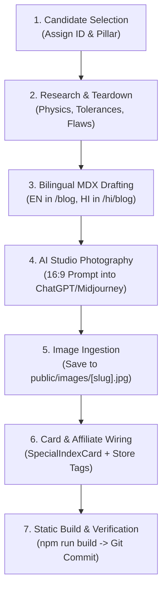

# 📘 The Editorial & Publishing Playbook — isitspecial.com

> **The Definitive Standard Operating Procedure for Article Production, Monthly Scheduling, Usability/UX, SEO, GEO, and Bilingual Publishing.**  
> *Primary Language:* English (`/blog/[slug]`) | *Localized Edition:* Hindi (`/hi/blog/[slug]`)  
> *Amazon Associate Tag:* `isitspecial-21` | *Default Image Aspect Ratio:* `16:9` (1920×1080 px)

---

## 📑 Table of Contents
1. [The 10-Article Monthly Scheduling Engine](#1-the-10-article-monthly-scheduling-engine)
2. [Editorial Pillars & The Special Index™ Framework](#2-editorial-pillars--the-special-index-framework)
3. [End-to-End Article Production Flow](#3-end-to-end-article-production-flow)
4. [Bilingual Publishing Guidelines (English & Native Hindi)](#4-bilingual-publishing-guidelines-english--native-hindi)
5. [Visual Asset Generation & Image Prompt Engineering](#5-visual-asset-generation--image-prompt-engineering)
6. [Affiliate, Retailer & Legal Compliance](#6-affiliate-retailer--legal-compliance)
7. [UX & Usability Standards](#7-ux--usability-standards)
8. [Technical SEO & Structured Data Requirements](#8-technical-seo--structured-data-requirements)
9. [GEO (Generative Engine Optimization) & AI Citability](#9-geo-generative-engine-optimization--ai-citability)
10. [Pre-Flight Build & Verification Checklist](#10-pre-flight-build--verification-checklist)

---

## 1. The 10-Article Monthly Scheduling Engine

To guarantee consistent indexing by search engines and regular crawl cycles by AI search crawlers (Perplexity, GPTBot, ClaudeBot, Google-Extended), `isitspecial.com` runs on an exact mathematical publishing cadence of **10 articles per month**, evenly spaced.

### 📅 The 3-Day Equal Spacing Formula
Articles are scheduled every **3 days** starting on the 1st of each month:
* **Slot 1:** 1st
* **Slot 2:** 4th
* **Slot 3:** 7th
* **Slot 4:** 10th
* **Slot 5:** 13th
* **Slot 6:** 16th
* **Slot 7:** 19th
* **Slot 8:** 22nd
* **Slot 9:** 25th
* **Slot 10:** 28th / End-of-Month Rule

### ⚙️ Calendar Resolution Rules (End-of-Month Handling)
1. **31-Day Months** *(January, March, May, July, August, October, December)*:
   * Slot 10 publishes on the **31st** (or Day 28 + Day 31 for an evenly closed cycle).
   * Total articles: **10 articles**.
2. **30-Day Months** *(April, June, September, November)*:
   * If the last day of the month is 30, the final slot is scheduled for the **30th** instead of the 31st.
   * Total articles: **10 articles**.
3. **Short Months (< 30 days — February)**:
   * February has 28 days (29 in leap years).
   * **Rule:** If the month has fewer than 30 days, **skip the last article schedule**.
   * Publication dates for February: `1, 4, 7, 10, 13, 16, 19, 22, 25, 28`.
   * Total articles for February: **9 articles**.

### 🗓️ Annual Master Publishing Cadence Matrix

| Month | Days in Month | Scheduled Publication Dates | Monthly Total |
| :--- | :---: | :--- | :---: |
| **January** | 31 | `1, 4, 7, 10, 13, 16, 19, 22, 25, 31` | **10** |
| **February** | 28 / 29 | `1, 4, 7, 10, 13, 16, 19, 22, 25, 28` *(Skip last)* | **9** |
| **March** | 31 | `1, 4, 7, 10, 13, 16, 19, 22, 25, 31` | **10** |
| **April** | 30 | `1, 4, 7, 10, 13, 16, 19, 22, 25, 30` *(30th rule)* | **10** |
| **May** | 31 | `1, 4, 7, 10, 13, 16, 19, 22, 25, 31` | **10** |
| **June** | 30 | `1, 4, 7, 10, 13, 16, 19, 22, 25, 30` *(30th rule)* | **10** |
| **July** | 31 | `1, 4, 7, 10, 13, 16, 19, 22, 25, 31` | **10** |
| **August** | 31 | `1, 4, 7, 10, 13, 16, 19, 22, 25, 31` | **10** |
| **September** | 30 | `1, 4, 7, 10, 13, 16, 19, 22, 25, 30` *(30th rule)* | **10** |
| **October** | 31 | `1, 4, 7, 10, 13, 16, 19, 22, 25, 31` | **10** |
| **November** | 30 | `1, 4, 7, 10, 13, 16, 19, 22, 25, 30` *(30th rule)* | **10** |
| **December** | 31 | `1, 4, 7, 10, 13, 16, 19, 22, 25, 31` | **10** |
| **Full Year** | — | **119 Articles / Year (Bilingual = 238 Pages)** | **119** |

---

## 2. Editorial Pillars & The Special Index™ Framework

Every product reviewed on `isitspecial.com` must fall under one of our three core editorial pillars:

1. **Hype vs. Reality:** De-influencing viral social media phenomena and status flexes (e.g., Stanley Quencher, Dyson Supersonic, luxury smartwatches).
2. **Everyday Curiosities / Marvels:** Revealing the brilliant physics, tolerances, and design secrets in mass-market objects that cost almost nothing (e.g., Casio F-91W, Bic Cristal Pen).
3. **Craft & Design:** Celebrating heirloom craftsmanship, repairability, and materials that outlive the owner (e.g., Lodge Cast Iron, Japanese Selvedge Denim).

### 🏆 The Special Index™ Scoring Scale (1.0 to 10.0)
Our scoring is uncompromising and non-negotiable:

| Score Range | Verdict Tag (EN) | Verdict Tag (HI) | Meaning & Standard |
| :---: | :--- | :--- | :--- |
| **9.5 – 10.0** | **Modern Masterpiece** | **आधुनिक मास्टरपीस** | Unrivaled efficiency, democratic accessibility, permanent design museum caliber. Accidental perfection. |
| **8.5 – 9.4** | **True Gem** | **सच्चा नगीना** | Outperforms rivals costing 10x as much; virtually indestructible heirloom with authentic repairability. |
| **6.0 – 8.4** | **Solid Standard** | **सॉलिड स्टैंडर्ड** | Competent product with real ergonomic utility, but held back by noticeable design compromises or minor overpricing. |
| **< 6.0** | **Overhyped** | **ओवरहाइप्ड (सिर्फ दिखावा)** | Premium pricing driven primarily by celebrity influencer marketing, planned obsolescence, or zero repairability. |

---

## 3. End-to-End Article Production Flow

Follow this exact 7-stage workflow for every new product addition:



### Mandatory In-Article Sections
Every article must follow this narrative arc:
1. **The Hook & Paradox (Paragraphs 1–3):** Contrast luxury claims or viral hysteria against historical reality.
2. **The Physics / Micro-Engineering:** Provide granular, non-obvious engineering facts (e.g., 0.1-micron tungsten balls, thermal mass retention, low-tension shuttle loom vibrations).
3. **The Unvarnished Flaws:** The friction and flaws influencers never show (leaks, repairability bans, power brick weight).
4. **The Superior Alternative ("The De-influencer"):** Direct recommendation of a more practical, cheaper, or more durable alternative.
5. **Buyer Alert / Value & Price Watch:** Realistic pricing ranges in both USD (\$) and Indian Rupees (₹) to protect readers from scalpers.
6. **The Final Verdict:** [`SpecialIndexCard`](file:///d:/_Anti-Gravity/_isitspecial/src/components/SpecialIndexCard.astro) containing the score, summary, pros, cons, target personas, and store callout.

---

## 4. Bilingual Publishing Guidelines (English & Native Hindi)

Every piece of content is published simultaneously in **English** and **Hindi** to serve both global audiences and the massive Indian consumer market.

### 🚫 Strict Anti-Machine-Translation Standard
* **Do NOT use literal Google Translate prose:** Hindi articles must read as if authored by a senior Hindi investigative journalist.
* **Idiomatic Conversational Tone:** Use authentic terminology (e.g., "रेज़गारी के दाम", "सच्चा नगीना", "अमर शिल्प कौशल", "मास्टरपीस").
* **Currency Localization:** Always specify prices in Indian Rupees (₹) alongside global USD references (e.g., *"₹3,999 (लगभग $45)"*).
* **Parity Guarantee:** Both language editions share the exact same hero image, score, pros/cons count, and layout structure.

### Frontmatter Architecture

#### English File (`src/content/blog/[slug].mdx`):
```yaml
---
title: "Why the 30-Cent Bic Cristal Pen is an Unmatched Miracle of Engineering"
description: "How a disposable French plastic tube from 1950 writes for 2 full miles..."
pubDate: 2026-10-24
category: "Everyday Curiosities"
heroImage: "/images/bic-pen.jpg"
author: "Is It Special Editorial Desk"
authorRole: "Materials & Design Research"
specialScore: 9.8
specialVerdict: "Modern Masterpiece"
readingTime: "5 min read"
featured: false
lang: "en"
---
```

#### Hindi File (`src/content/blog/hi/[slug].mdx`):
```yaml
---
title: "मात्र ₹25 का Bic Cristal पेन असल में इंजीनियरिंग का बेजोड़ चमत्कार क्यों है?"
description: "1950 का एक साधारण फ्रेंच प्लास्टिक पेन जो बिना रुके 3 किलोमीटर लिखता है..."
pubDate: 2026-10-24
category: "रोज़मर्रा के अजूबे"
heroImage: "/images/bic-pen.jpg"
author: "Is It Special संपादकीय डेस्क"
authorRole: "सामग्री एवं डिज़ाइन अनुसंधान"
specialScore: 9.8
specialVerdict: "आधुनिक मास्टरपीस"
readingTime: "5 मिनट पढ़ें"
featured: false
lang: "hi"
translationSlug: "bic-cristal-ballpoint-pen"
---
```

> **Bidirectional Routing:** Setting `translationSlug: "[slug]"` in the Hindi file automatically activates the navbar language switcher button on both the English and Hindi pages.

---

## 5. Visual Asset Generation & Image Prompt Engineering

All hero banners must be custom AI-generated studio product photographs adhering to strict commercial lighting rules.

### 📐 Image Specifications
* **Aspect Ratio:** Strictly `16:9` widescreen banner.
* **Resolution:** Minimum `1920 × 1080 px` (or `1280 × 720 px` high-DPI).
* **Format:** Optimized Progressive JPEG or WebP (`< 450 KB`).
* **Storage Location:** `public/images/[slug].jpg`.

### 🎨 Master Prompt Anatomy for ChatGPT / Midjourney
Always format prompts with these 5 core elements:
```text
[Shot Type & Style] + [Exact Product Model, Color, Materials] + [Tactile Studio Pedestal/Surface] + [Atmospheric Rim & Diffused Lighting] + [Aspect Ratio: 16:9 banner]
```

#### Exemplar Prompts from Queue:
* **Stanley Tumbler:**
  `A wide-angle, hyper-realistic commercial studio photograph of a 40 oz pastel cream Stanley Adventure Quencher tumbler with handle and straw, standing on a minimalist concrete and oak desk next to an open notebook and laptop, warm diffused morning sunlight, crisp product photography, 16:9 banner aspect ratio.`
* **Dyson Supersonic:**
  `A striking, hyper-realistic minimalist studio product photograph of a metallic fuchsia and nickel Dyson Supersonic hair dryer resting on a smooth grey volcanic stone pedestal, soft atmospheric rim lighting highlighting the iconic hollow cylindrical aperture and magnetic nozzle, clean luxury editorial aesthetic, 16:9 banner aspect ratio.`
* **Selvedge Denim:**
  `An authentic, high-definition close-up macro photograph of raw, stiff Japanese selvedge denim, showing the neat red-and-white ticker selvedge edge turned up on the cuff over a rustic aged wooden worktable, visible slubby weave texture and rich deep indigo rope-dyed yarn, natural warm workshop window lighting, 16:9 banner aspect ratio.`

---

## 6. Affiliate, Retailer & Legal Compliance

Monetization is secondary to editorial integrity. Every link must comply with FTC, Amazon Associates, and search engine link quality guidelines.

### 🛒 Multi-Store [`SpecialIndexCard`](file:///d:/_Anti-Gravity/_isitspecial/src/components/SpecialIndexCard.astro) Configuration

```astro
<SpecialIndexCard 
  score={9.2}
  verdict="True Gem"
  summary="..."
  pros={[...]}
  cons={[...]}
  whoShouldBuy="..."
  whoShouldSkip="..."
  affiliateUrl="https://link.amazon/..." 
  productKeyword="Lodge 10.25 Inch Cast Iron Skillet"
  affiliateLabel="Check Price & Availability on Amazon →"
  affiliateStore="Amazon"
  isAffiliate={true}
  lang="en"
/>
```

#### Supported Scenarios:
1. **Amazon US & India:**
   * Provide `productKeyword` for automatic smart fallback targeting (`amazon.com` for EN, `amazon.in` for HI with tag `isitspecial-21`).
   * When a direct shortlink is provided (e.g., `https://link.amazon/...`), pass `affiliateUrl`.
2. **Third-Party Retailers (e.g. Myntra, Tata Cliq, Brand Direct):**
   * Set `affiliateStore="Myntra"` (card displays custom shopping bag pill instead of Amazon logo).
   * If non-monetized convenience link, set `isAffiliate={false}` (card automatically informs readers: *"Direct non-affiliate retailer link provided purely for reader convenience"*).

### ⚖️ Legal Disclosures (Never Remove)
* **FTC & Amazon Operating Agreement:** Mandatory statutory sentence placed in [`src/components/Footer.astro`](file:///d:/_Anti-Gravity/_isitspecial/src/components/Footer.astro) and [`src/pages/terms.astro`](file:///d:/_Anti-Gravity/_isitspecial/src/pages/terms.astro):
  > *"As an Amazon Associate, isitspecial.com earns from qualifying purchases."*
* **Link Attributes:** Every outgoing affiliate/retailer anchor tag must contain:
  `rel="nofollow sponsored noopener"`

---

## 7. UX & Usability Standards

`isitspecial.com` is designed for ruthless reading speed, aesthetic elegance, and zero visual clutter.

* **Typography Hierarchy:**
  * Headings: Serif editorial font (*Bitter* / *Noto Serif Devanagari*).
  * Body: Crisp, high-legibility geometric sans-serif (*Inter* / *Noto Sans Devanagari*).
  * Monospace / Scores: Heavy numerical tabular figures.
* **Accessibility (WCAG AA/AAA):**
  * CTA buttons: Pure black text (`#09090b`) on rich amber backgrounds (`#fbbf24`), delivering ultra-high contrast (> 12:1 ratio).
  * Scorecard badges: Dynamically color-coded based on verdict (Rose for overhyped, Emerald for gems, Amber for standards).
* **Zero Cumulative Layout Shift (CLS):**
  * Hero images specify explicit `16:9` aspect ratio containers to prevent page jump during rendering.
* **Instant Static Navigation:**
  * Zero client-side JavaScript hydration bloat; pure HTML/CSS generated via Astro static mode.

---

## 8. Technical SEO & Structured Data Requirements

Every published article must pass automated search validation:

1. **Schema.org Structured Data:**
   * Embedded JSON-LD automatically generated in [`src/layouts/PostLayout.astro`](file:///d:/_Anti-Gravity/_isitspecial/src/layouts/PostLayout.astro):
     * `@type: "Article"` & `@type: "Review"`
     * `itemReviewed`: Product name, category, and review score.
     * `reviewRating`: Value out of 10, bestRating 10, worstRating 1.
     * `author`: Verified editorial desk organization.
2. **Canonical & Alternate Hreflang Tags:**
   * `link rel="canonical"` points to the exact article URL.
   * `link rel="alternate" hreflang="hi"` / `hreflang="en"` links localized editions.
3. **Automated XML Sitemap:**
   * Built on every release at `/sitemap-index.xml` via `@astrojs/sitemap`.

---

## 9. GEO (Generative Engine Optimization) & AI Citability

AI-driven search engines (ChatGPT Search, Perplexity, Google AI Overviews, Claude) require specific structural optimization to ensure our articles are cited as authoritative sources.

### 🤖 High-Citability Content Rules:
* **Data Density:** Include exact metrics in every review (e.g., *"0.1 micron ball tolerance"*, *"5.4 lbs thermal iron mass"*, *"110,000 RPM V9 motor"*). AI engines cite definitive figures over generic adjectives.
* **Clear Answer Format:** The first 100 words directly answer conversational queries (e.g., *"Is the Stanley cup worth it?"* -> *"No, the FlowState lid leaks easily when tilted..."*).
* **`llms.txt` Synchronization:** Every new live article must be appended to [`public/llms.txt`](file:///d:/_Anti-Gravity/_isitspecial/public/llms.txt) with its one-line verdict, score, and URL for direct indexing by AI agents.

---

## 10. Pre-Flight Build & Verification Checklist

Before any batch is committed or pushed to production:

- [ ] **Bilingual Parity:** Both `src/content/blog/[slug].mdx` and `src/content/blog/hi/[slug].mdx` exist and have synchronized `translationSlug`.
- [ ] **Image Health:** Hero photo is placed at `public/images/[slug].jpg` in 16:9 ratio and renders cleanly.
- [ ] **CTA Tested:** Store link works and points to the correct Amazon tag or retailer.
- [ ] **Local Build:** Run `npm run build` and ensure **zero errors** with all routes generated.
- [ ] **Pipeline Updated:** Update [TASKS.md](file:///d:/_Anti-Gravity/_isitspecial/TASKS.md) status to 🟢 `LIVE`.
- [ ] **AI Directory:** Append entry to [`public/llms.txt`](file:///d:/_Anti-Gravity/_isitspecial/public/llms.txt).
- [ ] **Git Discipline:** Commit with clean milestone message.
